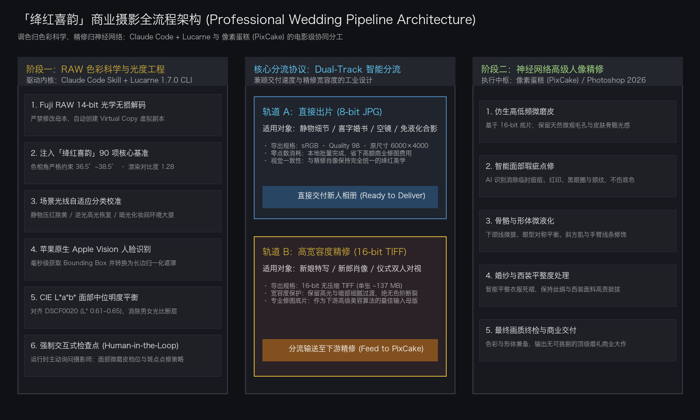
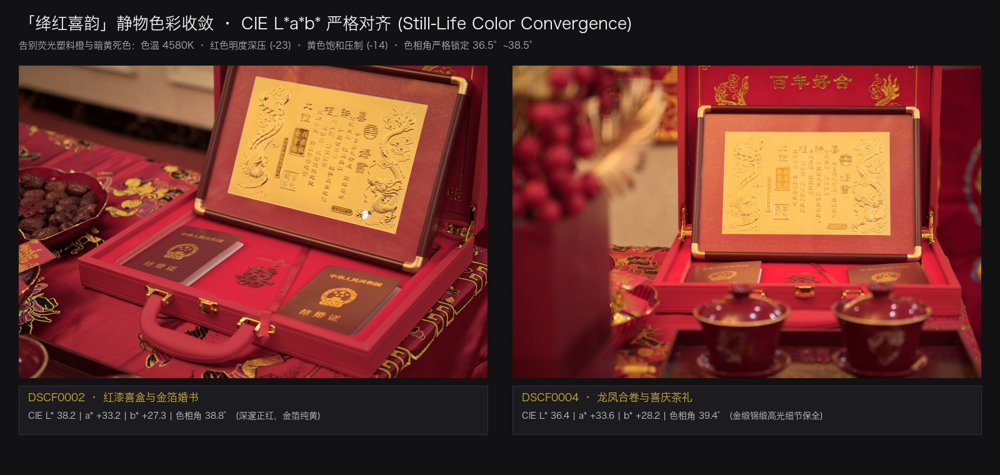
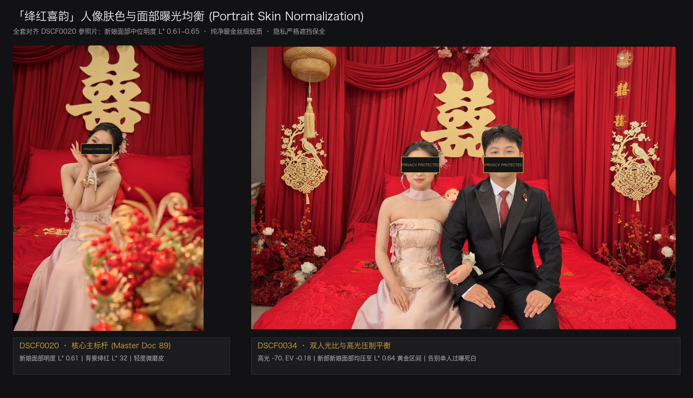
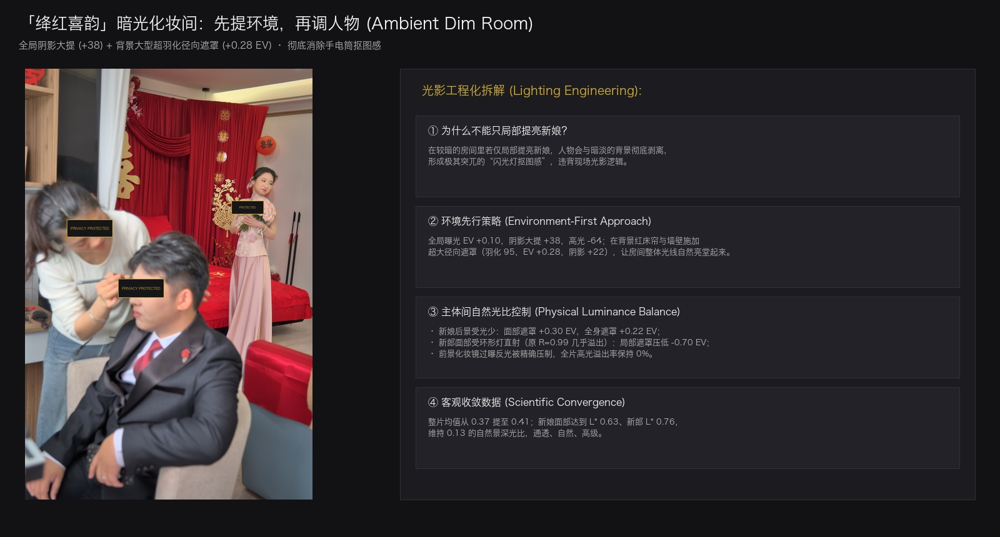

# Crimson Wedding Grade · 绛红喜韵

[English](README.md) | [简体中文](README.zh-CN.md)

**Crimson Wedding Grade** (`crimson-wedding-grade`) is a specialized Claude Code skill and automated RAW color grading pipeline for wedding and bridal portrait photography, distilled from real-world Fuji X-T2 RAW post-production within [Lucarne](https://lucarne.app).

It achieves a refined, celebratory painterly aesthetic: deep, noble crimson wedding reds without fluorescent orange or fuchsia cast, creamy skin tones with subtle golden warmth, rich contrast without muddiness, and an objective colorimetric target driven by CIE L\*a\*b\* science.



---

## Visual Showcases & Colorimetric Validation

> Note: To strictly safeguard personal privacy, all portrait images below have been masked across the eye level while preserving facial skin luminance, hair definition, warm golden highlights, gown lace details, and crimson backdrop purity for color grading review and technical reference.

### 1. Still-Life Details & Gold Foil: Banishing Fluorescent Orange and Muddy Yellow
Still-life items such as red lacquer boxes, wedding vows, tea ceremonies, and floral bouquets often suffer from warm tungsten ambient light and digital red clipping, turning garish orange or dull mustard yellow. **Crimson Wedding Grade** cools the color temperature (4580K), suppresses red luminance (-23), and reduces yellow saturation (-14) to lock the red hue angle strictly within **$36.5^\circ \sim 38.5^\circ$**, while gold foil shines with authentic, brilliant gold luster.



### 2. Bridal Skin Tone & Facial Luminance Balance: Creamy Satin Glow
Portraits strictly follow the reference benchmark (DSCF0020), utilizing Apple Vision face detection and localized photometry to align bride and groom facial skin median luminance within **$L^* = 0.61 \sim 0.65$**. Highlights are delicately warmed (midtones hue 25, highlights hue 45) to prevent blown-out flat whites while retaining bone structure contours.



### 3. Ambient Dim Rooms: Environment-First Lighting Balance
In dark dressing rooms with mirror reflections and ring lights, brightening only the bride produces an artificial "flash cutout" look. The pipeline employs an **Environment-First strategy**: lifting global shadows (+38) with a wide, ultra-feathered background radial mask (+0.28 EV) to illuminate the entire room, then applying negative local masking (-0.70 EV) to the groom's overexposed ring-light highlights.



---

## Industrial Dual-Engine Architecture: Color Science Meets AI Retouching

In commercial portrait photography, a common misconception is: *"Can AI retouching apps (such as 像素蛋糕 / PixCake, Evoto, Photoshop) handle color grading on their own?"*

The reality: **Color grading and facial retouching are fundamentally decoupled in imaging science, serving as complementary partners.**

| Dimension | Upstream: Claude Code + Lucarne (`crimson-wedding-grade`) | Downstream: 像素蛋糕 (PixCake) / Photoshop |
| :--- | :--- | :--- |
| **Film Industry Role** | **DIT / Digital Image Technician & Chief Colorist** | **Senior Beauty Retoucher & High-End Finisher** |
| **Core Mission** | 14-bit RAW optical decoding, tonal grading, locking crimson hue angle, balancing ambient lighting ratios | Skeletal liquify, biometric high/low frequency smoothing, acne/blemish healing, wrinkle removal |
| **Data Domain** | Raw sensor voltages, linear dynamic range, color matrices, still-life decor | Facial mesh topology, muscle flow, feature proportions, clothing fabric creases |
| **Output Deliverable**| **16-bit Uncompressed sRGB TIFF** (~137 MB each) + **8-bit JPG** | Final Master Album for Client Delivery |

### Why AI Retouching Apps Cannot Replace this Skill
1. **Sensor Dynamic Range**: Fuji RAF contains up to 14 bits of linear data. Heavy shadow lifting (+38) and highlight recovery (-64) must be applied during RAW demosaicing to prevent posterization and color noise. Generic AI retouching engines use standard debayering and lack deep camera matrix calibration.
2. **Still-Life is a Blind Spot for AI Retouchers**: Weddings contain vows, lacquer boxes, wedding shoes, rings, and banquet rooms. AI retouchers driven by face meshes cannot apply hue angle constraints to objects. This skill guarantees consistent color harmony across the entire shoot.
3. **SaaS Credit Optimization**: Commercial retouching platforms charge per export credit. By batch grading in Lucarne for free locally, only approved close-up portraits are exported to 16-bit TIFF for retouching credits.

---

## Key Features

- 🎨 **Canonical Recipe**: 90-operation baseline JSON controlling exposure, tone curves, split-toning, HSL color balance, detail, and optical corrections.
- 🔬 **Objective LAB Color Matching**: Scripted NumPy analyzer (`measure_lab.py`) comparing image regions and hue angles against target color standards instead of subjective visual guesswork.
- 🛡️ **Adaptive Lighting Calibration**:
  - **Wedding Details / Still Life (`detail`)**: De-yellowing and red luminance suppression for lacquer boxes, wedding vows, and gold-foil elements.
  - **Outdoor Backlit / Veil Recovery (`backlit`)**: Highlight compression (-38) and color temp cooling (4580K) preserving delicate lace textures.
  - **Indoor Ambient / Dim Makeup Rooms (`dim_room`)**: Wide ambient lifting (+38 shadows, +0.28 EV radial mask) before subject exposure balancing to avoid artificial "spotlight cutout" looks.
- 🤝 **Interactive Retouch Checkpoint**: Facial skin smoothing (micro-pore softening) and blemish/acne healing are **never hardcoded** into presets; the assistant interactively prompts the user for preferred intensity and treatment path.
- 🚀 **macOS Native Automation**:
  - `detect_faces.swift`: High-speed bounding box extraction using Apple Vision (`VNDetectFaceRectanglesRequest`).
  - Coordinate Normalizer: Translates Vision coordinates into Lucarne's long-edge-normalized radial gradient masks.
  - `build_sheets.py`: Generates multi-column overview sheets and 100% crop skin texture inspection strips.
- 📦 **Dual-Track Delivery**:
  - **Direct Delivery (8-bit JPG)**: Quality 98, sRGB for still-life details, wide decor shots, and non-retouch portraits.
  - **High-Dynamic Retouch (16-bit TIFF)**: Uncompressed 16-bit sRGB TIFFs (~137 MB each) for portrait shots requiring manual figure liquify or AI retouching in Photoshop / 像素蛋糕.

---

## Directory Structure

```
crimson-wedding-grade/
├── SKILL.md                          # Claude Code Skill entrypoint & workflow protocol
├── README.md                         # English documentation
├── README.zh-CN.md                   # Chinese documentation
├── LICENSE                           # MIT License
├── docs/
│   └── assets/                       # Architecture diagrams and privacy-masked showcases
│       ├── 01_still_life_crimson_gold.jpg
│       ├── 02_bridal_portrait_skin_tone.jpg
│       ├── 03_ambient_dim_room_balance.jpg
│       └── 04_dual_track_pipeline_architecture.png
├── references/
│   ├── crimson_baseline_recipe.json  # Complete 90-operation Lucarne baseline JSON
│   ├── color_science_and_lab.md      # Target LAB values, hue angles & grading science
│   └── lucarne_cli_reference.md      # Lucarne CLI RPC syntax, proto3 schemas & gotchas
└── scripts/
    ├── detect_faces.swift            # Native Apple Vision face detector (Swift)
    ├── apply_grade.py                # Batch grading & local mask injection CLI
    ├── measure_lab.py                # CIE L*a*b* & luminance objective analyzer
    └── build_sheets.py               # Review contact sheet and 100% skin strip generator
```

---

## Installation & Setup

### 1. Requirements

- macOS 13+ (Ventura, Sonoma, Sequoia)
- [Lucarne](https://lucarne.app) 1.7.0+ installed at `/Applications/Lucarne.app`
- Python 3.9+ with `Pillow` and `numpy`
- Swift command-line tools (`swiftc` bundled with Xcode Command Line Tools)

### 2. Install as a Claude Code Skill

Clone this repository into your local agents skills directory and symlink to `~/.claude/skills/`:

```bash
mkdir -p ~/.agents/skills
git clone https://github.com/tianshuo886/crimson-wedding-grade.git ~/.agents/skills/crimson-wedding-grade
ln -s ~/.agents/skills/crimson-wedding-grade ~/.claude/skills/crimson-wedding-grade
```

---

## Usage in Claude Code

Once installed, Claude Code automatically recognizes the skill when you work with wedding photos or Fuji RAW files in Lucarne.

### Natural Language Invocations

You can trigger the workflow simply by asking Claude:

- *"Apply Crimson Wedding Grade to this set of photos in Lucarne."*
- *"使用「绛红喜韵」调色管线处理这批婚礼 RAW 照片。"*
- *"/crimson-wedding-grade"*

### Interactive Workflow Execution

1. **Environment Check**: Confirms Lucarne catalog access and toolchain availability.
2. **Interactive Checkpoint**: Claude prompts for facial smoothing level (Light / Medium / None) and blemish treatment path.
3. **Virtual Copy Duplication**: Creates non-destructive virtual copies for all source photos.
4. **Baseline Ingestion**: Applies the 90-operation `crimson_baseline_recipe.json`.
5. **Adaptive Scene Tuning**: Classifies photos into Still-life, Backlit, or Dim Room and applies calibrated adjustments.
6. **Face Exposure Normalization**: Analyzes face skin luminance and balances subjects toward median $L^* = 0.61 \sim 0.65$.
7. **Contact Sheet Review**: Builds `00_总览.jpg` and `01_皮肤100%_检查.jpg` for user approval.
8. **Dual-Track Export**: Automatically exports 16-bit TIFFs for retouching and 8-bit JPEGs for final delivery.

---

## Standalone CLI Usage

The scripts can also be used independently of Claude:

```bash
# Set catalog environment
export LUCARNE_CATALOG="$HOME/Library/Application Support/Lucarne/Catalogs/Library.lucarnecatalog"

# Apply baseline and scene adaptation to document ID 105
python3 scripts/apply_grade.py 105 --scene detail

# Measure CIE L*a*b* values of a rendered image
python3 scripts/measure_lab.py rendered_preview.jpg
```

---

## License

MIT License. See [LICENSE](LICENSE) for details.
