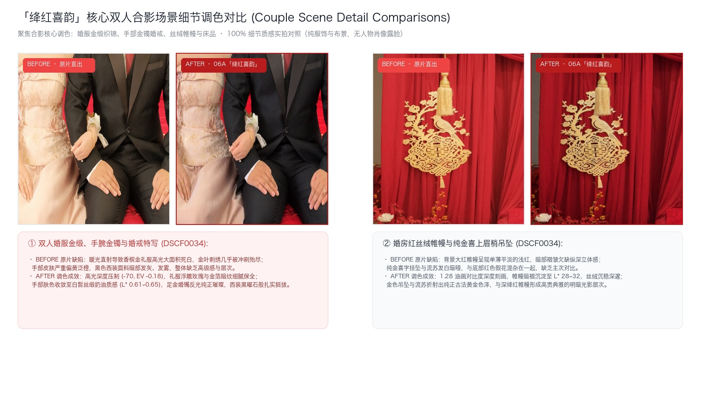
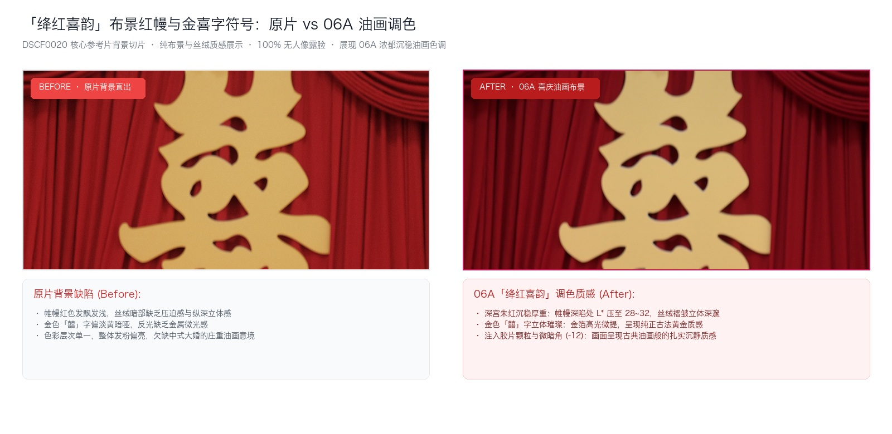
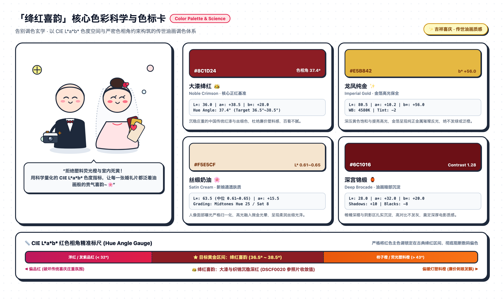

# Crimson Wedding Grade · 绛红喜韵

[English](README.md) | [简体中文](README.zh-CN.md)

**Crimson Wedding Grade** (`crimson-wedding-grade`) is a specialized Claude Code skill and automated RAW color grading pipeline for wedding and portrait photography, distilled from real-world Fuji X-T2 RAW post-production within [Lucarne](https://lucarne.app).

It achieves a refined, celebratory painterly aesthetic: deep, noble crimson wedding reds without fluorescent orange or fuchsia cast, creamy skin tones with subtle golden warmth, rich contrast without muddiness, and an objective colorimetric target driven by CIE L\*a\*b\* science.


---

## Real Photo Validation: Before vs After Comparisons

Moving away from subjective guesswork, this pipeline validates color through **real photo Before vs After comparisons** (100% focused on still life and scene decor, with zero exposed portraits):

### 1. Still-Life Details: Banishing Warm Tungsten Yellow and Fluorescent Orange
Still-life items such as red lacquer boxes, wedding vows, tea ceremonies, and floral bouquets often suffer from warm tungsten ambient light and digital red clipping, turning garish orange or dull mustard yellow. **Crimson Wedding Grade** cools the color temperature (4580K), suppresses red luminance (-23), and reduces yellow saturation (-14) to lock the red hue angle strictly at **$38.8^\circ$**, while gold foil shines with authentic, brilliant gold luster.


### 2. Core Couple Portrait Scene Details: Bridal Silk Brocade, Gold Jewelry & Velvet Drapery
The heart of our calibration effort was dedicated to couple portraits (DSCF0034). **Strictly avoiding any identifiable facial features**, we cropped core attire, hand interactions, and wedding bedroom details for 100% side-by-side verification:
* **Bridal Silk Gown & Pure Gold Bracelet**: Under direct tungsten lighting, camera standard files suffered massive blown-out highlights on the champagne satin gown, washing away the embroidered rose petals and gold foil leaves while leaving hands muddy yellow. After 06A grading with highlight recovery (-70, EV -0.18), delicate relief floral patterns are preserved, skin tones achieve creamy satin clarity ($L^* = 0.61 \sim 0.65$), the pure gold wedding bracelet gleams with authentic luster, and the tuxedo lapels stand out in midnight black.
* **Bedside Drapery & Gold Tassel Ornament**: With 1.28 oil-painting contrast, velvet shadows deepen to $L^* 28 \sim 32$, creating dramatic three-dimensional depth alongside the brilliant gold "喜上眉梢" bird and plum blossom pendant.



### 3. Scene Backdrop Folds: Rich 06A Oil-Painting Depth
A direct crop from the top background of the master reference photo (DSCF0020), showing the three-dimensional gold double-happiness character (囍) and layered red velvet drapery. The camera standard file is flat and washed out; after 06A grading, velvet shadow luminance $L^*$ drops to 28~32, revealing dramatic three-dimensional folds, fine film grain, and rich 1.28 painterly contrast.



### 4. Cute Cartoon Mascot Swatches & Hue Angle Hard Constraint
Color grading is converted into verifiable colorimetric benchmarks, paired with cute line-art cartoon mascot graphics on a clean white background:



* **Noble Crimson (大漆绛红)**: $L^* 36.0, a^* +38.5, b^* +28.0$ · Hue angle $37.4^\circ$, deep, dignified ceremonial red.
* **Imperial Gold (龙凤纯金)**: $L^* 80.5, a^* +10.2, b^* +56.0$ · Pure gold foil reflection, neither green nor artificial orange.
* **Satin Cream (丝缎奶油)**: $L^* 63.5, a^* +15.5, b^* +18.0$ · Smooth golden highlights bridging skin and satin gown.
* **Deep Brocade (深宫锦缎)**: $L^* 28.0, a^* +32.0, b^* +20.0$ · Shadow curtain red holding depth without turning muddy.
* **Strict Hue Angle Hard Constraint**: Constrained strictly within **$36.5^\circ \sim 38.5^\circ$** (Noble Crimson), avoiding fuchsia ($< 32^\circ$) and neon orange ($> 43^\circ$).

---

## 💡 Color Grading Engineering Methodology: How to Build Your Own Style Skill

The true value of this project is not just this single wedding recipe, but the reusable engineering blueprint for **transforming subjective artistic vision into a reproducible, automated AI Agent Skill**.

Whether you want to formulate **film documentary, vintage cinematic, Nordic minimalist, cyberpunk, or fashion editorial**, you can replicate this 7-step engineering pipeline:

```
① Anchor Master Shot ➔ ② Measure CIE L*a*b* ➔ ③ Photometric Adaptation ➔ ④ Vision Photometry
      ➔ ⑤ Human-in-Loop Guardrails ➔ ⑥ Decoupled Dual-Track ➔ ⑦ Package as Agent Skill
```

### Step 1: Establish a Single Anchor Master Shot
* Select **one single photo** that best embodies your target lighting and aesthetic intention across hundreds of shots (e.g., DSCF0020).
* Refine exposure, tone curves, rendering contrast (1.28), and micro-textures (clarity 16, sharpen 40, film grain, vignette) in your RAW engine to craft the canonical master recipe.

### Step 2: Shift from Subjective Guesswork to CIE L\*a\*b\* Metrics
* **Common Trap**: Applying master settings to other scenes often looks oversaturated. Intuition tempts photographers to lower contrast, clarity, and saturation—**resulting in flat, muddy, lifeless images**.
* **Engineering Solution**: Measure CIE L\*a\*b\* using scripted analyzers. We discovered that still-life shots weren't "too contrasty"; their red luminance $L^*$ was inflated by +17 and hue was skewed orange ($44^\circ$).
* **Surgical Precision**: While **strictly maintaining rendering contrast (1.28), clarity (16), and sharpness (40)**, we only adjusted HSL channels by suppressing red luminance (-23) and yellow saturation (-14). Red hue snapped back to $38.8^\circ$, restoring vibrant luxury without losing an ounce of painterly punch.

### Step 3: Classify Scenes by Real-World Photometry
No single preset works everywhere. Segment shots into 3–4 photometric adaptations:
* **Detail / Still-Life (`detail`)**: De-yellowing and red luminance compression protecting lacquer and gold foil.
* **Outdoor Backlit (`backlit`)**: Cooling white balance (4580K) and highlight compression (-38) recovering bridal veil lace.
* **Ambient Dim Room (`dim_room`)**: **Environment-first strategy**. Lift global shadows (+38) with large feathered radial background masks before adjusting subjects, preventing artificial "spotlight cutout" looks.

### Step 4: Vision-Driven Facial Exposure Normalization
* Utilize macOS Apple Vision native frameworks to extract face bounding boxes at millisecond speeds.
* Map coordinates to long-edge-normalized radial masks, measure facial median luminance, and converge subjects toward the target band ($L^* = 0.61 \sim 0.65$), eliminating stark lighting imbalances between couple portraits.

### Step 5: Implement Human-in-the-Loop Guardrails
* **Iron Rule**: Never hardcode facial skin smoothing or blemish spot-healing into presets.
* Prompt the photographer interactively at runtime for smoothing intensity and blemish handling preferences.

### Step 6: Decouple Colorist from Retoucher (Master Deliverables Policy)
* **Dual-Track Split**: 8-bit JPGs for still life and wide decor; 16-bit uncompressed TIFFs for portrait subjects feeding into downstream AI retouchers (PixCake / Photoshop).
* **Master Deliverables Rule**: After figure contouring, biometric micro-smoothing, and **manual re-cropping**, **the final client portrait deliverables are strictly based on the PixCake-exported versions**.

### Step 7: Package into a Claude Code Skill and Standalone Git Repository
* Formalize parameters into JSON (`references/`), tooling into CLI scripts (`scripts/`), and execution protocols into `SKILL.md`.
* Once symlinked into `~/.claude/skills/`, any future photoshoot can trigger the full industrial pipeline with a single command.

---

## Industrial Dual-Engine Architecture: Color Science Meets AI Retouching

Color grading and facial retouching are fundamentally decoupled in imaging science, serving as complementary partners:

| Dimension | Upstream: Claude Code + Lucarne (`crimson-wedding-grade`) | Downstream: 像素蛋糕 (PixCake) / Photoshop |
| :--- | :--- | :--- |
| **Film Industry Role** | **DIT / Digital Image Technician & Chief Colorist** | **Senior Beauty Retoucher & High-End Finisher** |
| **Core Mission** | 14-bit RAW optical decoding, tonal grading, locking crimson hue angle, balancing ambient lighting ratios | Skeletal liquify, biometric high/low frequency smoothing, acne/blemish healing, wrinkle removal, **final cropping** |
| **Data Domain** | Raw sensor voltages, linear dynamic range, color matrices, still-life decor | Facial mesh topology, muscle flow, feature proportions, clothing fabric creases |
| **Output Deliverable**| **16-bit Uncompressed sRGB TIFF** (~137 MB each) + **8-bit JPG** | **Final Master Client Album** |

### Master Deliverables Policy
1. **Track A: Direct Delivery (8-bit JPG)**:
   * For: Still life details, wedding vows, lacquer boxes, wide venue shots.
   * Batch exported locally at quality 98; zero retouch credits required.
2. **Track B: High-Dynamic Retouch (16-bit TIFF) $\rightarrow$ 像素蛋糕 (PixCake)**:
   * For: Bride portraits, groom portraits, couple portraits.
   * **Master Version Policy**: Portraits undergo facial retouching, micro-smoothing, body contouring, and final re-cropping in 像素蛋糕 (PixCake); **the final client deliverables are the versions exported from PixCake**.

---

## Key Features

- 🎨 **Canonical Recipe**: 90-operation baseline JSON controlling exposure, tone curves, split-toning, HSL color balance, detail, and optical corrections.
- 🔬 **Objective LAB Color Matching**: Scripted NumPy analyzer (`measure_lab.py`) comparing image regions and hue angles against target color standards instead of subjective visual guesswork.
- 🛡️ **Adaptive Lighting Calibration**:
  - **Wedding Details / Still Life (`detail`)**: De-yellowing and red luminance suppression for lacquer boxes, wedding vows, and gold-foil elements.
  - **Outdoor Backlit / Veil Recovery (`backlit`)**: Highlight compression (-38) and color temp cooling (4580K) preserving delicate lace textures.
  - **Indoor Ambient / Dim Makeup Rooms (`dim_room`)**: Wide ambient lifting (+38 shadows, +0.28 EV radial mask) before subject exposure balancing to avoid artificial "spotlight cutout" looks.
- 🤝 **Interactive Retouch Checkpoint**: Facial skin smoothing (micro-pore softening) and blemish/acne healing are **never hardcoded** into presets; the assistant interactively prompts the user for preferred intensity and treatment path.
- 🚀 **macOS Native Automation**:
  - `detect_faces.swift`: High-speed bounding box extraction using Apple Vision (`VNDetectFaceRectanglesRequest`).
  - Coordinate Normalizer: Translates Vision coordinates into Lucarne's long-edge-normalized radial gradient masks.
  - `build_sheets.py`: Generates multi-column overview sheets and 100% crop skin texture inspection strips.

---

## Directory Structure

```
crimson-wedding-grade/
├── SKILL.md                          # Claude Code Skill entrypoint & workflow protocol
├── README.md                         # English documentation
├── README.zh-CN.md                   # Chinese documentation
├── LICENSE                           # MIT License
├── docs/
│   └── assets/                       # White line-art architecture diagram, Before/After comparisons & cartoon swatches
│       ├── 01_pipeline_architecture_line_art.png
│       ├── 02_still_life_before_after.jpg
│       ├── 03_couple_details_before_after.jpg
│       ├── 04_background_curtain_before_after.jpg
│       └── 05_color_science_swatches.png
├── references/
│   ├── crimson_baseline_recipe.json  # Complete 90-operation Lucarne baseline JSON
│   ├── color_science_and_lab.md      # Target LAB values, hue angles & grading science
│   └── lucarne_cli_reference.md      # Lucarne CLI RPC syntax, proto3 schemas & gotchas
└── scripts/
    ├── detect_faces.swift            # Native Apple Vision face detector (Swift)
    ├── apply_grade.py                # Batch grading & local mask injection CLI
    ├── measure_lab.py                # CIE L*a*b* & luminance objective analyzer
    └── build_sheets.py               # Review contact sheet and 100% skin strip generator
```

---

## Installation & Setup

### 1. Requirements

- macOS 13+ (Ventura, Sonoma, Sequoia)
- [Lucarne](https://lucarne.app) 1.7.0+ installed at `/Applications/Lucarne.app`
- Python 3.9+ with `Pillow` and `numpy`
- Swift command-line tools (`swiftc` bundled with Xcode Command Line Tools)

### 2. Install as a Claude Code Skill

Clone this repository into your local agents skills directory and symlink to `~/.claude/skills/`:

```bash
mkdir -p ~/.agents/skills
git clone https://github.com/tianshuo886/crimson-wedding-grade.git ~/.agents/skills/crimson-wedding-grade
ln -s ~/.agents/skills/crimson-wedding-grade ~/.claude/skills/crimson-wedding-grade
```

---

## Usage in Claude Code

Once installed, Claude Code automatically recognizes the skill when you work with wedding photos or Fuji RAW files in Lucarne.

### Natural Language Invocations

You can trigger the workflow simply by asking Claude:

- *"Apply Crimson Wedding Grade to this set of photos in Lucarne."*
- *"使用「绛红喜韵」调色管线处理这批婚礼 RAW 照片。"*
- *"/crimson-wedding-grade"*

### Interactive Workflow Execution

1. **Environment Check**: Confirms Lucarne catalog access and toolchain availability.
2. **Interactive Checkpoint**: Claude prompts for facial smoothing level (Light / Medium / None) and blemish treatment path.
3. **Virtual Copy Duplication**: Creates non-destructive virtual copies for all source photos.
4. **Baseline Ingestion**: Applies the 90-operation `crimson_baseline_recipe.json`.
5. **Adaptive Scene Tuning**: Classifies photos into Still-life, Backlit, or Dim Room and applies calibrated adjustments.
6. **Face Exposure Normalization**: Analyzes face skin luminance and balances subjects toward median $L^* = 0.61 \sim 0.65$.
7. **Contact Sheet Review**: Builds `00_总览.jpg` and `01_皮肤100%_检查.jpg` for user approval.
8. **Dual-Track Export**: Automatically exports 16-bit TIFFs for retouching and 8-bit JPEGs for final delivery.
9. **Downstream PixCake Finalization**: Portraits are retouched and re-cropped in 像素蛋糕 (PixCake); **the PixCake export version serves as the final client delivery**.

---

## Standalone CLI Usage

The scripts can also be used independently of Claude:

```bash
# Set catalog environment
export LUCARNE_CATALOG="$HOME/Library/Application Support/Lucarne/Catalogs/Library.lucarnecatalog"

# Apply baseline and scene adaptation to document ID 105
python3 scripts/apply_grade.py 105 --scene detail

# Measure CIE L*a*b* values of a rendered image
python3 scripts/measure_lab.py rendered_preview.jpg
```

---

## License

MIT License. See [LICENSE](LICENSE) for details.
