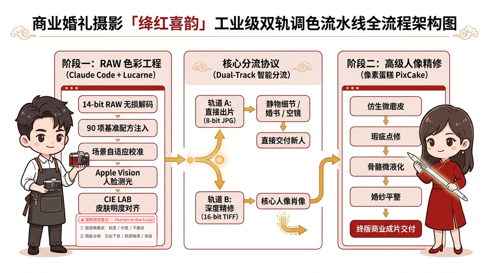
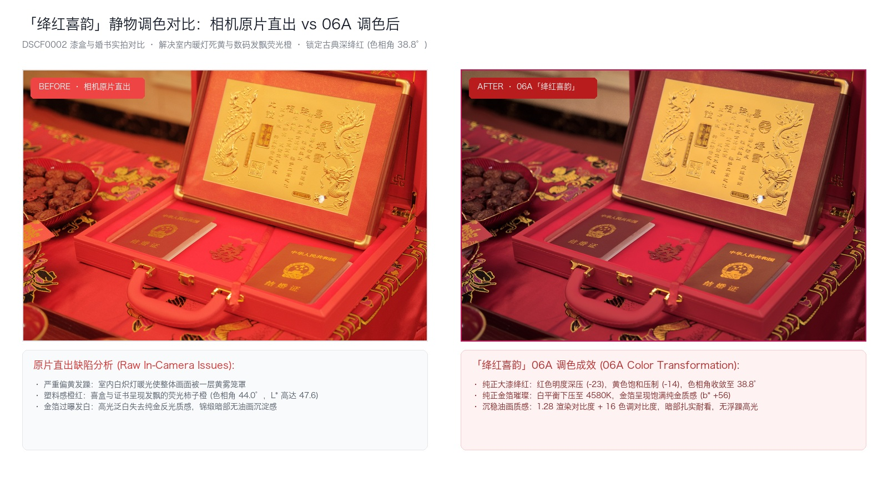
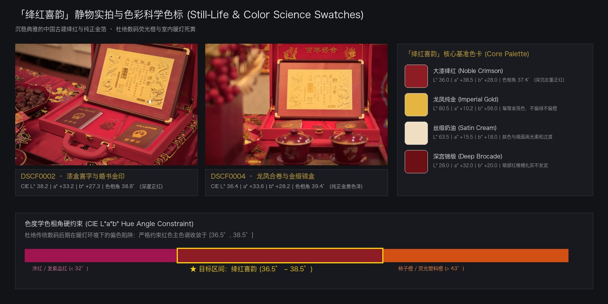

# 「绛红喜韵」· 富士婚礼油画调色技能 (Crimson Wedding Grade)

[English](README.md) | [简体中文](README.zh-CN.md)

**绛红喜韵** (`crimson-wedding-grade`) 是专为婚礼与肖像摄影打造的 Claude Code 专业技能与自动化调色流水线，沉淀自富士 X-T2 RAW 格式在 [Lucarne](https://lucarne.app) 中的真实后期实战。

它旨在呈现兼具**中式传统喜庆感与古典油画耐看质感**的调色风格：纯正典雅的深沉绛红、温润通透的奶油金暖肤色、沉稳浓郁而不发泥的明暗层次，并通过严密的 CIE L\*a\*b\* 色度学指标实现客观收敛。



---

## 真实实拍对比：调色前后 (Before vs After)

摒弃传统“拉滤镜、凭肉眼瞎调”的主观玄学，本技能以**真实照片调色前后客观对照**为基准（100% 聚焦静物与场景布景，不含任何人物肖像露脸）：

### 1. 静物对比：告别室内暖灯死黄与发飘塑料橙
中式婚礼中的红漆喜盒、龙凤婚书、喜糖茶礼极易受到室内白炽灯暖光与数码传感器红色溢出的双重干扰，直出往往是一层厚重的黄雾笼罩，红盒沦为廉价刺眼的“荧光柿子橙”。「绛红喜韵」将色温降至 4580K，深压红色明度 (-23) 与黄色饱和 (-14)，将红色相角严格收敛于 $38.8^\circ$ 的古典大漆绛红，金箔呈现纯正灿烂的真金色泽。



### 2. 场景布景细节：06A 浓郁沉稳油画质感
截取自核心参考片（DSCF0020）顶部的立体金色「囍」字与层叠红丝绒帷幔。相机直出原片帷幔浅红发飘，暗部散漫无力；经过 06A「绛红喜韵」调色后，帷幔深陷处明度 $L^*$ 压至 28~32，丝绒立体深邃，结合 1.28 油画渲染对比度与微胶片颗粒，呈现出沉稳典雅的大婚油画意境。


### 3. 色彩科学色卡与色相角硬约束
本技能将调色拆解为可量化、可验证的数字色度学标准：



* **大漆绛红 (Noble Crimson)**：$L^* 36.0, a^* +38.5, b^* +28.0$ · 色相角 $37.4^\circ$，深沉庄重正红。
* **龙凤纯金 (Imperial Gold)**：$L^* 80.5, a^* +10.2, b^* +56.0$ · 纯净金箔色，不偏绿也不发假橙。
* **丝缎奶油 (Satin Cream)**：$L^* 63.5, a^* +15.5, b^* +18.0$ · 肤色与缎面高光柔和过渡，泛出温润微金。
* **深宫锦缎 (Deep Brocade)**：$L^* 28.0, a^* +32.0, b^* +20.0$ · 暗部红帷幔扎实沉着，绝不发灰发泥。
* **色相角硬约束**：严格收敛于 **$36.5^\circ \sim 38.5^\circ$**（绛红喜韵），彻底避开发紫的洋红（$< 32^\circ$）与刺眼的柿子橙（$> 43^\circ$）。

---

## 💡 调色工程化通用方法论：如何沉淀属于你自己的调色 Skill？

本项目的真正价值不仅在于「绛红喜韵」这一套婚礼配方，更在于验证了一套**“将摄影审美数字化、工程化并固化为 AI Agent Skill”的通用实战方法论**。

无论您是要沉淀**日系胶片、复古港风、北欧极简、赛博朋克还是商业时尚**，均可完整复用以下 7 步工程化流水线：

```
① 锚定单张母本 ➔ ② 测算 LAB 数值 ➔ ③ 分解光照自适应 ➔ ④ 原生视觉测光
       ➔ ⑤ 交互安全护栏 ➔ ⑥ 双轨解耦交付 ➔ ⑦ 固化为 Agent 技能仓库
```

### 步骤 1：先立单张“黄金标杆”，切忌大水漫灌 (Anchor Master Shot)
* 从整场拍摄几百张照片中，挑选出光线最丰富、最能表达您审美愿景的**唯一一张母本**（例如本案例中的 DSCF0020）。
* 在 RAW 显影工具（Lucarne / Lightroom / Capture One）中反复推敲：建立核心影调曲线、渲染对比度（1.28）、微观质感（清晰度 16/锐化 40/暗角/胶片颗粒），形成最初的 Master Recipe。

### 步骤 2：从“肉眼玄学”跃迁至“CIE L\*a\*b\* 数据” (Objective Metrics)
* **经典踩坑**：当把母本参数套用到静物或其他场景时，肉眼发现偏艳，直觉常误以为是“对比度太高”，盲目调低对比度、清晰度与饱和度——**结果画面立即发灰、发暗、发脏**。
* **工程化破局**：编写 Python 分析脚本测量 CIE L\*a\*b\*。我们发现静物的问题根本不是对比度，而是红色明度 $L^*$ 虚高了 17，色相角偏向了橙色的 $44^\circ$。
* **手术刀式调优**：在**绝对维持渲染对比度（1.28）、清晰度（16）、锐化（40）不变**的前提下，仅在 HSL 通道**深压红色明度 (-23) 与黄色饱和度 (-14)**，色相角瞬间精准回落到古典绛红黄金区间 $38.8^\circ$。画面瞬间通透高级，分毫不失油画质感。

### 步骤 3：按物理光照环境做场景自适应分支 (Scene Photometric Adaptation)
商业拍摄不存在“一刀切”的万能预设，必须根据现场物理布光归纳为 3~4 个自适应分支：
* **静物细节分支 (`detail`)**：专属除黄压红，保全金箔与大漆质感。
* **户外逆光分支 (`backlit`)**：色温下压至 4580K，高光大压 (-38)，保全高光蕾丝细节。
* **室内暗房分支 (`dim_room`)**：**环境先行策略**。先全局大提阴影 (+38) 与背景超羽化径向遮罩，再微调人物，彻底杜绝“手电筒抠图突兀感”。

### 步骤 4：原生视觉驱动面部曝光归一化 (Vision-Driven Normalization)
* 调用 macOS 原生 Apple Vision 毫秒级提取人脸 Bounding Box，自动转换为软件长边归一化局部径向渐变遮罩。
* 测定面部皮肤中位明度，将全组人脸统一归一化至风格黄金区间（如本风格的 $L^* = 0.61 \sim 0.65$），从根本上消除双人合影中一人死白一人死黑的布光硬伤。

### 步骤 5：留出人机协同交互检查点 (Human-in-the-Loop Guardrails)
* **铁律**：面部磨皮强弱与斑点/痘痘点修**绝不可强行写死在预设中**。
* 在 Agent 运行时，主动向摄影师交互询问档位（轻度/中度/不磨皮）与瑕疵点修路径，兼顾自动化效率与摄影师决策权。

### 步骤 6：解耦调色与精修，确立终版成片标准 (Decouple & Master Policy)
* **分流协议**：8-bit JPG 负责静物空镜本地秒级出片；16-bit uncompressed TIFF 负责核心人像输送给下游修图软件（像素蛋糕 / Photoshop）。
* **终版交付准则**：人物照片在下游经过高级仿生磨皮、形体微液化以及**摄影师二次构图裁切**后，**最终商业成片交付一律以像素蛋糕导出的版本为准**。

### 步骤 7：打包为标准化 Claude Code Skill 与独立 Git 仓库 (Packaging)
* 将核心参数固化为 JSON (`references/`)、算法与测光工具脚本化 (`scripts/`)、交互逻辑协议化 (`SKILL.md`)。
* 只要将仓库克隆至 `~/.agents/skills/` 并软链接至 `~/.claude/skills/`，随时随地在终端输入指令即可批量调用。

---

## 工业级全流程架构：调色与精修的电影级协同

在商业摄影工业界，调色与精修是两个在底层逻辑上完全解耦的工序，两者分工协作：

| 维度 | 上游：Claude Code + Lucarne (`crimson-wedding-grade`) | 下游：像素蛋糕 (PixCake) / Photoshop |
| :--- | :--- | :--- |
| **电影工业角色** | **DIT 数字影像工程师 / 首席调色师 (Colorist)** | **高级妆造修图师 / 商业精修师 (Retoucher)** |
| **核心职责** | 掌控 14-bit RAW 光学无损解码、定光影影调、锁定「绛红喜韵」色相角、平衡环境光比 | 骨骼形体液化、AI 仿生高低频微磨皮、祛痘祛痣、去颈纹眼袋、面部平整度、**最终重裁切** |
| **处理对象** | RAW 原始光电信号、传感器动态范围、色彩空间变换、全片静物与布景 | 人脸网格拓扑、肌肉走势、五官比例、服饰死褶平整 |
| **交付产物** | **16-bit 深度无压缩 sRGB TIFF** (单张 ~137 MB) + **8-bit JPG** | **终版商业成片交付客户** |

### 核心分流与终版成片原则 (Master Deliverables Policy)
1. **轨道 A：直接出片 (8-bit JPG)**：
   * 适用于：静物特写、龙凤婚书、喜字漆盒、婚礼空镜、现场环境。
   * 本地秒级导出，无需消耗商业修图点数，直接作为最终成片交付。
2. **轨道 B：高宽容度精修 (16-bit TIFF) $\rightarrow$ 像素蛋糕 (PixCake)**：
   * 适用于：新娘肖像、新郎肖像、仪式双人合影等核心人像。
   * **终版成片依据**：人像部分经过像素蛋糕进行精细微磨皮、骨骼微液化与**最终构图重新裁切**，**最终交付以像素蛋糕导出的版本为主**。

---

## 核心特性与技术规范

- 🎨 **经典基准配方**：90 项参数构成的 `crimson_baseline_recipe.json`，涵盖精准白平衡、胶片色调曲线、色彩分级、微观纹理与微暗角。
- 🔬 **客观色度学分析工具**：内置 `measure_lab.py` 分析脚本，自动提取全图与红区 CIE L\*a\*b\* 均值及色相角，摆脱主观肉眼调色偏差。
- 🛡️ **三大环境自适应校准**：
  - **静物 / 喜字婚书 / 红漆金箔 (`detail`)**：专属压红明度（-12 ~ -23）与强力除黄（黄饱和 -14），使金箔璀璨、红漆深红。
  - **户外逆光 / 白纱迎亲 (`backlit`)**：色温降至 4580K，高光大压 -38，完美保全蕾丝婚纱细节与纯洁冷白。
  - **室内暗光 / 化妆间 (`dim_room`)**：环境全局阴影大提（+38）与背景大型径向遮罩提亮，彻底消除突兀的“闪光灯抠图感”。
- 🤝 **强制交互检查点**：面部平滑（毛孔微磨皮）与斑点/痘痘点修**绝不写死在预设中**；执行时主动向摄影师交互询问档位（轻度/中度/不磨皮）与交付路径。
- 🚀 **macOS 原生工具链**：
  - `detect_faces.swift`：基于 Apple Vision 原生框架高精度毫秒级提取人脸 Bounding Box。
  - 坐标归一化转换器：将 Vision 图像坐标映射至 Lucarne 长边归一化径向渐变局部遮罩。
  - `build_sheets.py`：自动输出整套多列选片总览拼图与 100% 原尺寸面部质感复核图。

---

## 目录结构

```
crimson-wedding-grade/
├── SKILL.md                          # Claude Code Skill 入口定义与交互协议
├── README.md                         # 英文文档
├── README.zh-CN.md                   # 中文文档
├── LICENSE                           # MIT 许可证
├── docs/
│   └── assets/                       # 白底线条架构图、调色前后实拍对比图与色标
│       ├── 01_pipeline_architecture_line_art.png
│       ├── 02_still_life_before_after.jpg
│       ├── 03_background_curtain_before_after.jpg
│       └── 04_color_science_swatches.jpg
├── references/
│   ├── crimson_baseline_recipe.json  # 完整的 90 项 Lucarne 核心基准 JSON
│   ├── color_science_and_lab.md      # CIE L*a*b* 色度学标准与色相角规范
│   └── lucarne_cli_reference.md      # Lucarne CLI 协议、坐标体系与避坑要点
└── scripts/
    ├── detect_faces.swift            # 苹果原生 Apple Vision 人脸识别 (Swift)
    ├── apply_grade.py                # 批量调色应用与局部遮罩注入脚本
    ├── measure_lab.py                # CIE L*a*b* 色度与中位明度测量工具
    └── build_sheets.py               # 拼图总览与 100% 皮肤复核图生成工具
```

---

## 安装与配置

### 1. 运行依赖

- macOS 13+ (Ventura, Sonoma, Sequoia)
- [Lucarne](https://lucarne.app) 1.7.0+（位于 `/Applications/Lucarne.app`）
- Python 3.9+ 并安装 `Pillow` 与 `numpy`
- Xcode 命令行工具（包含 `swiftc`）

### 2. 作为 Claude Code 技能安装

将本仓库克隆至本地 agents skills 目录，并软链接至 Claude Code 技能目录：

```bash
mkdir -p ~/.agents/skills
git clone https://github.com/tianshuo886/crimson-wedding-grade.git ~/.agents/skills/crimson-wedding-grade
ln -s ~/.agents/skills/crimson-wedding-grade ~/.claude/skills/crimson-wedding-grade
```

---

## 在 Claude Code 中使用

安装完成后，在涉及婚礼照片调色或富士 RAW 格式处理的对话中，Claude Code 将自动识别并推荐此技能。

### 自然语言唤起示例

- *“对这批婚礼照片应用「绛红喜韵」调色管线。”*
- *“帮我把选出的这几张富士婚礼 RAW 调成 绛红喜韵 风格。”*
- *“/crimson-wedding-grade”*

### 标准执行流程

1. **环境检查**：验证 Lucarne 编目环境及相关脚本可用性。
2. **交互检查点**：主动向您确认面部微磨皮强度（轻度/中度/不磨皮）及瑕疵点修方案。
3. **创建虚拟副本**：无损复制原始文件版本，绝不触碰原片。
4. **注入基准配方**：一键应用 `crimson_baseline_recipe.json`。
5. **场景光线自适应**：自动识别静物、逆光或暗光环境并注入校准参数。
6. **面部曝光均衡**：测量面部肤色明度，平衡至 $L^* = 0.61 \sim 0.65$ 黄金区间。
7. **拼图复核交付**：生成全景总览图与 100% 皮肤裁切拼图供您确认。
8. **双轨规格导出**：根据照片用途自动分别导出 16-bit 精修 TIFF 或高质量 8-bit JPG。
9. **下游精修定稿**：人物肖像导入像素蛋糕进行液化微调与裁剪，**最终以像素蛋糕导出的成片为交付版本**。

---

## 独立命令行运行

该脚本亦可独立于 Claude 在终端中直接运行：

```bash
# 设置 Lucarne 编目路径
export LUCARNE_CATALOG="$HOME/Library/Application Support/Lucarne/Catalogs/Library.lucarnecatalog"

# 对指定照片文档 (ID: 105) 应用静物场景调色
python3 scripts/apply_grade.py 105 --scene detail

# 测量已渲染图像的 CIE L*a*b* 色度数值
python3 scripts/measure_lab.py rendered_preview.jpg
```

---

## 开源协议

本项目采用 MIT 许可证，详情请参阅 [LICENSE](LICENSE)。
